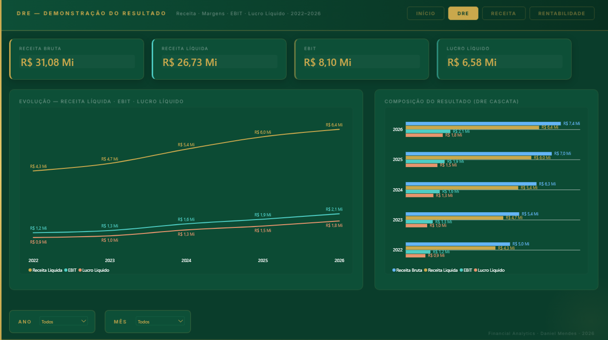
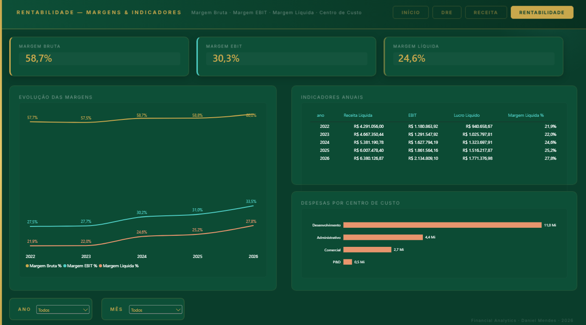
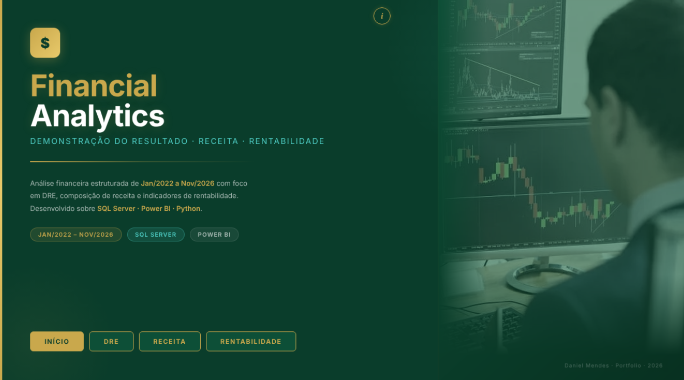
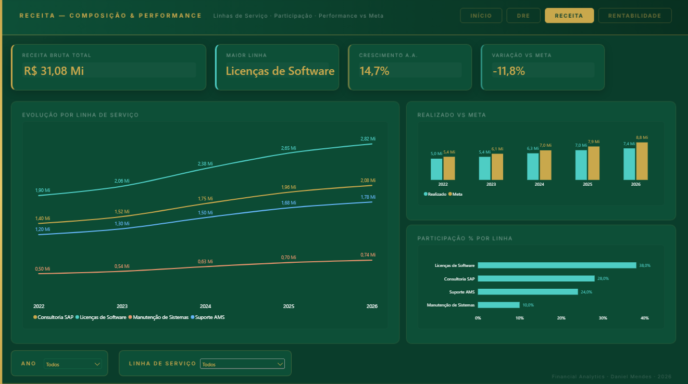

# 📊 Financial Analytics — O problema não é o desempenho, é a meta

> Análise da DRE de ponta a ponta: SQL Server → Power BI → Python


---

## 📌 Resumo Executivo

**Pergunta de negócio:** a empresa cresce com saúde? E por que nunca bate a meta?

**Resposta:** a operação é saudável e cada vez mais eficiente. O que está descalibrado é a meta.

| # | Achado | Evidência |
|---|--------|-----------|
| 1 | **A receita cresce de forma consistente** | +11,9% ao ano entre 2022 e 2025 (de R$ 5,0 Mi para R$ 7,0 Mi) · 2026: +14,7% comparando jan–nov |
| 2 | **Cada real a mais de receita gera mais lucro** | Margem EBIT de 27,5% para 33,5% · custos fixos crescem 6% a.a., e o peso deles cai de 23,2% para 18,1% da receita líquida |
| 3 | **Mesmo assim, a receita nunca alcança a meta** | De 8% a 12% abaixo em todos os anos completos · a meta sobe 13% a.a. em ritmo fixo e já nasceu 9% acima do realizado |

**Recomendação:** recalibrar a meta pela tendência histórica e pela sazonalidade, acompanhá-la mês a mês (acumulado do ano) e proteger a disciplina de custos fixos.

### 📽️ Apresentação

| Arquivo | Para quê |
|---------|----------|
| [📄 Financial_Analytics_Apresentacao.pdf](apresentacao/Financial_Analytics_Apresentacao.pdf) | Leitura rápida: 12 slides de negócio + 5 de apêndice técnico |
| [📊 Financial_Analytics_Apresentacao.pptx](apresentacao/Financial_Analytics_Apresentacao.pptx) | Versão editável, com notas do apresentador |

---

## 📊 Dashboard Power BI

### DRE
Receita bruta, receita líquida, EBIT e lucro líquido, com a evolução anual e a DRE em cascata.



### Rentabilidade
Margens bruta, EBIT e líquida (ponderadas pela receita), indicadores anuais e custos por centro de custo.



<details>
<summary><b>Ver as outras páginas (Início e Receita)</b></summary>

### Início


### Receita
Receita por linha de serviço, participação, crescimento (comparando os mesmos meses) e realizado contra a meta.



</details>

---

## 🏗️ Arquitetura

```
SQL Server (4 tabelas + 6 views)  →  Power BI (4 páginas + medidas DAX)  →  Python (5 gráficos)  →  GitHub
```

A DRE é calculada uma única vez, na view `vw_DRE`: o Power BI e o Python leem a mesma regra, então os números batem entre as ferramentas.

### 🗄️ Modelagem de Dados (SQL Server)

**Tabelas:**
- `Plano_Contas`: estrutura da DRE (receitas, deduções, custos, despesas, resultado financeiro e impostos)
- `Centro_Custo`: Desenvolvimento, Comercial, Administrativo, Suporte Técnico, Diretoria e P&D
- `Lancamentos_Financeiros`: tabela fato com os lançamentos mensais (jan/2022 a nov/2026)
- `Metas_Anuais`: meta anual de receita por linha de serviço

**Views (camada de consumo):**

| View | O que entrega | Consumida por |
|------|---------------|---------------|
| `vw_DRE` | DRE mensal completa, da receita bruta ao lucro líquido, com margens | Power BI |
| `vw_Receita_Composicao` | Receita por linha de serviço e participação | Power BI · Python |
| `vw_Despesas_Centro_Custo` | Custos e despesas por centro de custo | Power BI · Python |
| `vw_Performance_vs_Meta` | Receita realizada contra a meta anual | Power BI · Python |
| `vw_Indicadores_Rentabilidade` | KPIs e margens ponderadas por ano, com meses apurados | Power BI · Python |
| `vw_Painel_Executivo_Financeiro` | Crescimento mês a mês e ano a ano (`LAG`) e acumulado do ano | Consultas analíticas |

**Destaques de SQL:** geração da base com CTEs (crescimento, sazonalidade, eventos e custos fixos, semifixos e variáveis), window functions (`LAG`, `SUM OVER`) e DRE completa numa view. Script em [`sql/Financial analytics projeto.sql`](sql/Financial%20analytics%20projeto.sql).

---

## 🐍 Análise Python

Script que conecta ao SQL Server via `pyodbc` e gera 5 gráficos em matplotlib, com títulos calculados a partir dos dados e o ano parcial sinalizado:

| # | Gráfico | Tipo |
|---|---------|------|
| 01 | Receita Bruta por Ano | Barras verticais |
| 02 | Receita por Linha de Serviço | Barras empilhadas |
| 03 | Realizado vs Meta | Colunas agrupadas |
| 04 | Evolução das Margens | Linhas |
| 05 | Custos e Despesas por Centro de Custo | Barras horizontais |

### Como executar

```bash
# 1. Criar e ativar ambiente virtual
python -m venv venv
venv\Scripts\activate          # Windows

# 2. Instalar dependências
pip install pyodbc pandas matplotlib numpy

# 3. Configurar conexão em Python/financial_analysis.py
SERVER   = "localhost"         # seu servidor SQL Server
DATABASE = "Financial_Analytics"

# 4. Executar a partir da raiz do projeto
python Python/financial_analysis.py
# → Gráficos salvos em charts/
```

---

## 📐 Definições das Métricas

| Métrica | Definição |
|---------|-----------|
| Receita líquida | Receita bruta − deduções (ISS, PIS/COFINS e outros tributos) |
| Margens (%) | Lucro bruto, EBIT ou lucro líquido ÷ receita líquida, somados no período (ponderadas pela receita) |
| Crescimento a.a. | Receita do ano atual ÷ ano anterior − 1, comparando **os mesmos meses** nos dois anos |
| Atingimento da meta | Receita realizada total ÷ meta total − 1 |

> **Ano parcial:** 2026 tem 11 meses apurados (jan–nov). Contra a meta do ano inteiro o desvio é −15,9%; com a meta proporcional a 11 meses, fica em torno de −8% a −9%, em linha com os anos anteriores.

---

## ✅ Qualidade de Dados e Limitações

Antes da análise, o projeto foi revisado e corrigido: os KPIs da capa estavam desenhados na imagem de fundo (sem ligação com os dados), a base dependia da data de execução (`GETDATE`), as margens apareciam com o formato de % errado (0,59% em vez de 58,7%), o crescimento comparava 11 meses com 12 e o atingimento da meta era uma média de percentuais.

**Limitações:** dados simulados · mix de receita constante entre as linhas de serviço nos cinco anos · meta definida só para a receita, sem orçamento de custos · 2026 com 11 meses.

---

## 📁 Estrutura do Repositório

```
projeto-financial-analytics/
├── apresentacao/      # Apresentação em PDF e PowerPoint
├── sql/               # Script SQL: tabelas, geração da base e views
├── Python/            # Script de análise em Python
├── charts/            # 5 gráficos gerados pelo Python
├── Screenshots/       # Prints das 4 páginas do dashboard
├── Backgrounds/       # Fundos customizados do dashboard
├── Financial_Analytics_Dashboard.pbix
└── README.md
```

---

## 🎨 Identidade Visual

| Cor | Hex | Uso |
|-----|-----|-----|
| Verde Escuro | `#0A3D2B` | Fundo principal |
| Verde Card | `#0D4F37` | Cards e áreas de gráfico |
| Dourado | `#C9A84C` | Destaques, títulos e série principal |
| Turquesa | `#4ECDC4` | Série de dados 2 |
| Laranja | `#E8956D` | Série de dados 3 e alertas |
| Azul Claro | `#64B5F6` | Série de dados 4 |

---

## 👤 Autor

**Daniel Mendes** · Analista de Dados | SQL · Power BI · Python

[Portfólio](https://claude.ai/artifact/TMgbaE1TNWBpaj9uPPN8XL) · [LinkedIn](https://www.linkedin.com/in/danielgmendes/) · [GitHub](https://github.com/DanielMendes-Dados)

---

*Projeto desenvolvido para portfólio profissional, com dados simulados de uma consultoria SAP (jan/2022 a nov/2026).*
